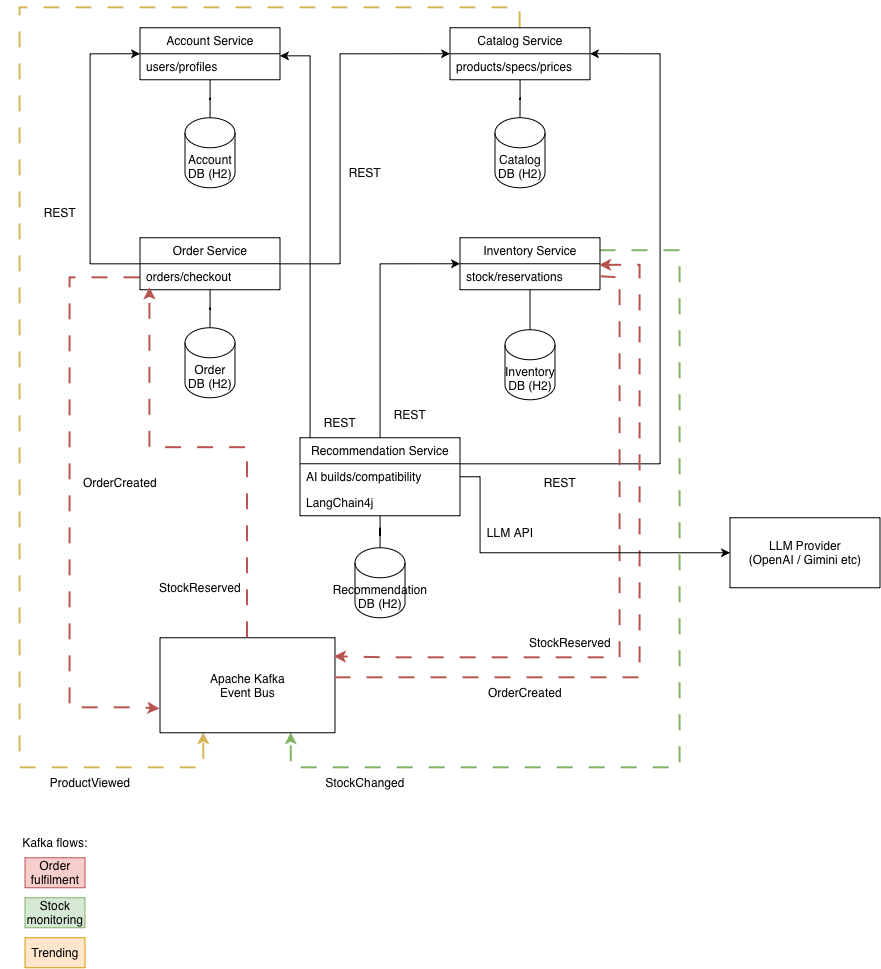

# Architecture

> Source: `source-docs/architecture.drawio.png`



## Diagram Summary

The diagram shows five microservices, each with its own H2 database, communicating synchronously over REST and asynchronously through an Apache Kafka event bus.

### Services

| Service | Responsibilities (as labelled) | Database |
|---|---|---|
| Account Service | users/profiles | Account DB (H2) |
| Catalog Service | products/specs/prices | Catalog DB (H2) |
| Order Service | orders/checkout | Order DB (H2) |
| Inventory Service | stock/reservations | Inventory DB (H2) |
| Recommendation Service | AI builds/compatibility, LangChain4j | Recommendation DB (H2) |

Ports and base path for each service are listed in [api-endpoints.md](api-endpoints.md#service-port-mapping-and-base-path).

### Synchronous REST Calls

| From | To |
|---|---|
| Order Service | Account Service |
| Order Service | Catalog Service |
| Order Service | Recommendation Service |
| Catalog Service | Inventory Service |
| Recommendation Service | Account Service |
| Recommendation Service | Catalog Service |
| Recommendation Service | Inventory Service |

The architecture diagram does not show the Order Service → Recommendation Service call (R3, decision 7) or the Catalog Service → Inventory Service call (C2 stock status, decision 8).

Calls to protected endpoints forward the customer's JWT in the `Authorization` header; calls to public endpoints need no token (decision 11).

### External Integration

| From | To | Via |
|---|---|---|
| Recommendation Service | LLM Provider (OpenAI / Gemini etc) | LLM API |

### Kafka Flows

| Flow | Event | Publisher → Consumer |
|---|---|---|
| Order fulfilment | OrderPlaced | Order Service → Apache Kafka Event Bus → Inventory Service (published on checkout, DRAFT → PLACED) |
| Order fulfilment | StockReserved | Inventory Service → Apache Kafka Event Bus → Order Service |
| Order fulfilment | StockReservationFailed | Inventory Service → Apache Kafka Event Bus → Order Service |
| Order fulfilment | OrderCancelled | Order Service → Apache Kafka Event Bus → Inventory Service |
| Order fulfilment | OrderCompleted | Order Service → Apache Kafka Event Bus → Inventory Service |
| Stock monitoring | StockChanged | Inventory Service → Apache Kafka Event Bus |
| Trending | ProductViewed | Catalog Service → Apache Kafka Event Bus → Catalog Service (trending list, decision 9) |

The architecture diagram labels the checkout event `OrderCreated`; the event name used in the specs is `OrderPlaced` (see decision 3). `StockReservationFailed`, `OrderCancelled` and `OrderCompleted` are not shown in the diagram (see decisions 4 and 6).

`StockChanged` is an integration/umbrella event representing inventory stock changes; it may be derived from the inventory events `StockLevelUpdated`, `StockLow` or `ProductRestocked` (see [event-sourcing.md](event-sourcing.md#33-event-types)).

### Kafka Event Contracts

Agreed contracts for the order flow (decision 14). Library: Spring for Apache Kafka. Messages are JSON strings.

| Topic | Key | Events | Publisher | Consumer (group) |
|---|---|---|---|---|
| `order-events` | `orderId` | `OrderPlaced`, `OrderCancelled`, `OrderCompleted` | Order Service | Inventory Service (`inventory-service`) |
| `inventory-reservation-events` | `orderId` | `StockReserved`, `StockReservationFailed` | Inventory Service | Order Service (`order-service`) |
| `inventory-stock-events` | `productId` | `StockChanged` | Inventory Service | none yet |

All events of one order are in one topic with the same key, so they are consumed in the order they were published.

Every event has the common fields `eventId` (UUID), `eventType`, `version` (integer, currently 1) and `occurredAt` (ISO-8601 UTC timestamp), plus:

| Event | Fields |
|---|---|
| `OrderPlaced` | `orderId`, `userId`, `items` (Array of {`productId`, `quantity`}) |
| `OrderCancelled` | `orderId`, `userId`, `reason` (`CUSTOMER_CANCELLED` / `PAYMENT_FAILED` / `PAYMENT_TIMEOUT`) |
| `OrderCompleted` | `orderId`, `userId` |
| `StockReserved` | `orderId`, `reservations` (Array of {`reservationId`, `productId`, `quantity`}) |
| `StockReservationFailed` | `orderId`, `reason` (`STOCK_UNAVAILABLE`), `unavailableItems` (Array of {`productId`, `requestedQuantity`, `availableQuantity`}) |
| `StockChanged` | `productId`, `quantity`, `reservedQuantity`, `change` (`STOCK_LEVEL_UPDATED` / `STOCK_LOW` / `PRODUCT_RESTOCKED`) |

Example (`OrderPlaced`):

```json
{
  "eventId": "6f1c2a3e-8d0b-4a7e-9c55-2b7d1e0f4a10",
  "eventType": "OrderPlaced",
  "version": 1,
  "occurredAt": "2026-10-14T03:15:00Z",
  "orderId": "order-123",
  "userId": "user-456",
  "items": [{ "productId": "product-789", "quantity": 2 }]
}
```

Processing rules:

- **All-or-nothing reservation.** For `OrderPlaced`, Inventory Service reserves stock for every item only when every item can be reserved, and publishes one `StockReserved` for the order. If any item cannot be reserved (not enough available stock, or no inventory record), nothing is reserved, no event is stored, and one `StockReservationFailed` is published.
- **Cancel and complete.** For `OrderCancelled`, Inventory Service releases every `ACTIVE` reservation of the order; for `OrderCompleted`, it confirms them. An order without active reservations is a no-op.
- **Repeated messages.** Inventory Service skips an `OrderPlaced` for an order that already has reservations. Order Service ignores a reservation result for an order that is not `PLACED`.
- **When events are published.** `OrderCancelled` is published only for an order that was `PLACED` or `PROCESSING` (not for a cancelled `DRAFT` order, and not after `StockReservationFailed`). `StockChanged` is published after a stock level update and when `StockLow` or `ProductRestocked` is raised.
- **Not on Kafka.** `PaymentStatusUpdated`, `StockNotificationSubscribed` and the event-sourced per-product inventory events stay inside their service.

## Architecture Decisions

| # | Topic | Status | Decision |
|---|---|---|---|
| 1 | Cart | Resolved | No separate Cart aggregate, entity or microservice. The Order aggregate also represents the shopping cart before checkout: a `DRAFT` order is the customer's cart, products can be added/removed while the order is `DRAFT`, and checkout transitions it to `PLACED`, after which the normal order / inventory / Kafka flow begins. Lifecycle: `DRAFT -> PLACED -> PROCESSING -> COMPLETED / CANCELLED` (see [Order Lifecycle](domain-model.md#33-order-lifecycle)). |
| 2 | Stock reservation timing | Resolved | Stock is reserved after checkout (order `PLACED`), when Inventory Service consumes `OrderPlaced` from Kafka. The FR-06 / I1 time limit applies to payment: if payment is not recorded within the time limit, the order is `CANCELLED` and the reservation is released via `OrderCancelled`. |
| 3 | Checkout event name | Resolved | The Kafka event published on checkout is `OrderPlaced` (matches DRAFT → PLACED); it replaces `OrderCreated`. `CheckoutStarted` (listed in the User Stories document for O1) is not used, because checkout is a single DRAFT → PLACED transition. |
| 4 | Order ↔ Inventory event flow | Resolved | `OrderPlaced` → reserve stock → `StockReserved` (order → PROCESSING) or `StockReservationFailed` (order → CANCELLED). `OrderCancelled` → release reservation. Payment success → COMPLETED → `OrderCompleted` → confirm reservation (decision 6). |
| 5 | Inventory reservation REST endpoints | Resolved | In the normal order flow, stock is reserved and released through Kafka events, not REST. The I1 REST endpoints (`POST`/`DELETE /inventory/{productId}/reservations`) are kept for direct use and testing. |
| 6 | Stock reservation confirmation | Resolved | When payment is recorded as PAID (order → COMPLETED), Order Service publishes `OrderCompleted`. Inventory Service consumes it and issues `ConfirmStockReservationCommand`, which records `StockReservationConfirmed`: the reservation becomes `CONFIRMED` and the reserved quantity is deducted from stock. |
| 7 | Order from a recommended build (R3) | Resolved | The endpoint is `POST /orders/from-recommendation/{recommendationId}`. Order Service calls Recommendation Service over REST (`GET /recommendations/{recommendationId}`) to get the build components, then creates a DRAFT order with them. |
| 8 | Product stock status (C2) | Resolved | Catalog Service calls Inventory Service over REST (`GET /inventory/{productId}`) to show current stock status in product details (FR-02). |
| 9 | Catalog events | Resolved | `ProductViewed` is the only Catalog event published to Kafka: it is published when product details are viewed (C2) and consumed by Catalog Service itself to maintain the trending list (C3, FR-03). `ProductCreated`, `ProductUpdated`, `ProductRemoved` and `ProductReviewed` are domain events internal to Catalog Service and are not published to Kafka. Payloads are listed in [Catalog Domain Events](domain-model.md#15-catalog-domain-events). |
| 10 | Product category and listing categories | Resolved | `Product` holds a required `categoryId` (Product 0..\* — 1 Category). `GET /categories` is added under C1 so that customers can browse products by category. |
| 11 | Authentication and authorisation (A2, NFR-04) | Resolved | Account Service authenticates users on `POST /auth/login` (username + password, checked against the BCrypt `passwordHash`) and issues a stateless JWT: HS256 signed with a secret shared by all services, 1-hour lifetime, claims `sub` (userId), `role`, `iat`, `exp`; no refresh token, logout or server-side session. Every service validates the token itself with Spring Security as an OAuth2 resource server and the same secret, without calling Account Service. `User` has a `role` (CUSTOMER/ADMIN): `POST /users` always creates CUSTOMER, and one ADMIN account is created by Account Service at startup from configuration. Customer endpoints require the token's userId to own the resource; administrative endpoints (C5, I3 `PUT`, I1 REST) require ADMIN. Synchronous calls to protected endpoints forward the customer's `Authorization` header. Access levels and errors: [Authentication and Authorisation](api-endpoints.md#authentication-and-authorisation). |
| 12 | Recommendation Service data access and AI flow (R1, R2) | Resolved | Recommendation Service reads products with Catalog `GET /products` and maps them locally (component type = Catalog category name, from `GET /categories`); it does not call `GET /products/{productId}`. It checks stock by calling Inventory `GET /inventory/{productId}` directly; only in-stock products can be recommended, and a 404 from Inventory means the product is not available. If Account, Catalog or Inventory Service is unavailable, the request fails with `ServiceUnavailable` (503). R1: Java collects the saved Account preference, the request preference (sent to the model separately; the request preference wins on conflict), the Catalog products and their stock, and LangChain4j sends this context to the LLM, which returns the selected product IDs and the reasoning; Java then re-checks that the IDs exist, takes prices from Catalog, and checks the budget and stock. No agent tool-calling for now. The LLM provider, model and API key come from configuration / environment variables; tests use a mocked LLM. The re-check also applies the R2 compatibility rules. If the LLM's answer is invalid, it is retried once with the validation errors as feedback; if the second answer is also invalid, R1 returns `CompatibilityConflict` (409). If an LLM call fails technically or times out, R1 returns `ServiceUnavailable` (503). R2 uses deterministic rules ([Component Types and Compatibility Rules](domain-model.md#55-component-types-and-compatibility-rules)), does not use the LLM and stores nothing. `BuildRequested`, `RecommendationGenerated` and `CompatibilityChecked` are internal domain events and are not published to Kafka. |
| 13 | Inventory record and stock rules (I1–I3) | Resolved | `InventoryResponse` is `productId`, `quantity`, `reservedQuantity`. An inventory record is created automatically by the first stock update for a product without one; nothing else initialises inventory, and Inventory Service does not call Catalog Service. A stock update sets the absolute quantity and is rejected when it would be lower than the reserved quantity. `StockLow` uses a configurable threshold (default 10) on available stock (`quantity − reservedQuantity`). DTOs and errors: [Inventory Service DTOs](api-endpoints.md#inventory-service-dtos). |
| 14 | Kafka integration library and event contracts | Resolved | Asynchronous communication uses Apache Kafka through Spring for Apache Kafka (`spring-kafka`). Messages are JSON; each consumer maps a message to its own classes. Topics, keys, event fields and processing rules are defined in [Kafka Event Contracts](#kafka-event-contracts). An order is reserved all-or-nothing and gets one reservation result. Events are published after the database transaction commits; a failed send is logged (no outbox), and a failing message is retried by the consumer and then skipped (no dead-letter topic). A local broker is provided by `docker-compose.yml`. Still open: how subscribed customers are notified of `StockLow` / `ProductRestocked` (I2) — `StockChanged` is published but has no consumer — and the Kafka part of Catalog's `ProductViewed` (C3). |
| 15 | Order cart, checkout and payment rules (O1, O2, O4) | Resolved | A customer has at most one `DRAFT` order. `unitPrice` is Catalog Service's stored price, read with `GET /products`; adding a product already in the cart increases its quantity. Checkout requires at least one item and a delivery address and returns 202 Accepted; the reservation result is communicated asynchronously through Kafka, so Order Service never returns `StockUnavailable` synchronously. The payment time limit is 10 minutes after the order becomes `PROCESSING`; a scheduled check in Order Service cancels overdue orders and publishes `OrderCancelled`. `PaymentStatusRequest` accepts `PAID` or `FAILED`. Error responses of all services use the body `{code, message}`. DTOs and errors: [Order Service DTOs](api-endpoints.md#order-service-dtos). |
